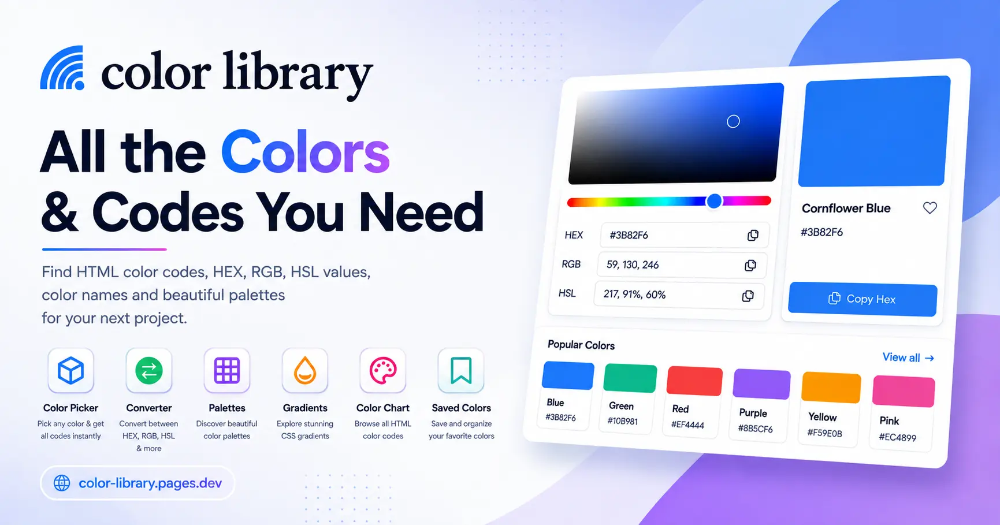

# Color Library

<p align="center">
  
</p>

<h1 align="center">Color Library</h1>

<p align="center">
  A fast, free, and developer-friendly color toolkit for exploring HTML color names, copying HEX/RGB/HSL values, building palettes, and creating custom color mixes.
</p>

<p align="center">
  <a href="https://color-library.pages.dev/">Live Demo</a> ·
  <a href="https://github.com/Unfavasik/Color-Library/issues">Report a Bug</a> ·
  <a href="https://github.com/Unfavasik/Color-Library/issues">Request a Feature</a>
</p>

<p align="center">
  
  
  
  
</p>



## Overview

**Color Library** is a browser-based color reference and design utility for developers, designers, students, and anyone working with digital colors. Search a large collection of named HTML colors, inspect their HEX and RGB values, convert colors to HSL, save favorites locally, and generate palettes without needing an external service.

The project is designed to work as a static website and can also be served locally through the included Express server. A production build copies the required application and public assets into `dist/`, making the project suitable for Vercel and other static hosting platforms.

## Highlights

- **Color search:** Find colors by name or HEX code from the global search or hero search field.
- **Interactive color picker:** Adjust hue, inspect a live swatch, and edit a HEX value directly.
- **Instant conversion:** View HEX, RGB, and HSL representations for the selected color.
- **One-click copying:** Copy HEX, RGB, and HSL values to the clipboard with visual feedback.
- **Color categories:** Browse colors by Red, Pink, Purple, Indigo, Blue, Cyan, Teal, Green, Yellow, Orange, Brown, Gray, Black, and White.
- **Sorting:** Organize the catalog by source order, name, lightness, or hue.
- **Saved colors:** Favorite colors and persist them in the browser using `localStorage`.
- **Recently viewed:** Keep track of recently inspected colors locally in the browser.
- **Color Mix:** Generate combinations and gradients from multiple selected colors.
- **Palettes and gradients:** Explore curated palette and CSS gradient sections from the main interface.
- **Responsive UI:** Designed for desktop, tablet, and mobile screens.
- **Accessible interactions:** Uses semantic controls, labels, keyboard-friendly actions, and live status messages.
- **SEO and sharing support:** Includes metadata, Open Graph tags, Twitter card data, JSON-LD, sitemap, robots rules, favicon assets, and a web app manifest.
- **Static-hosting friendly:** Includes Vercel configuration, redirects, headers, and a deterministic production build.

## Live Demo

Visit the deployed application at **[color-library.pages.dev](https://color-library.pages.dev/)**.

## Tech Stack

| Area | Technology |
| --- | --- |
| Frontend | Semantic HTML, modern CSS, and vanilla JavaScript |
| Local server | Node.js and Express 4 |
| Development runner | `tsx` |
| Build | Custom Node.js build script |
| Client storage | Browser `localStorage` |
| Deployment target | Vercel or any static hosting provider |
| Fonts/assets | Local project assets with no frontend framework dependency |

## Getting Started

### Prerequisites

Install the following before running the project:

- **Node.js 18 or newer**
- **npm 9 or newer**
- A modern browser such as Chrome, Firefox, Safari, or Edge

### Installation

```bash
git clone https://github.com/Unfavasik/Color-Library.git
cd Color-Library
npm install
```

### Start the development server

```bash
npm run dev
```

Open [http://localhost:3000](http://localhost:3000) in your browser.

The `dev` command uses `tsx` to run `server.ts` directly. The server listens on port `3000` and serves both the application root and the clean route directories.

### Start the server without the development runner

```bash
npm start
```

### Preview the application

```bash
npm run preview
```

## Production Build

Create a deployment-ready copy in `dist/`:

```bash
npm run build
```

The build script:

1. Removes any previous `dist/` directory.
2. Copies the application HTML, CSS, JavaScript, fonts, images, and route assets.
3. Copies the contents of `public/` into the production output.
4. Verifies required files such as `index.html`, `ch.css`, `ch.js`, sitemap, robots rules, manifest, and favicon assets.
5. Reports a failure if a required production file is missing.

Serve the generated output locally with:

```bash
npm start
```

## Available Routes

| Route | Purpose |
| --- | --- |
| `/` | Main color catalog, search, picker, converter, saved colors, palettes, and gradients |
| `/color-mix` | Color mixing and generated palette workspace |
| `/about` | Project and creator information |
| `/contact` | Contact page |
| `/privacy-policy` | Privacy policy |
| `/terms-of-service` | Terms of service |
| `/htmcolor.html` | HTML color reference page |

The Express server and the static deployment configuration support clean URLs for the dedicated route directories.

## How to Use

### Search for a color

Type a color name such as `Blue`, `Cornflower`, or a HEX value such as `#3B82F6` into either search field. The catalog filters as you type.

### Inspect and copy color values

Select a color card or use the picker. The selected color displays its:

- HEX value, such as `#3B82F6`
- RGB value, such as `59, 130, 246`
- HSL value, such as `217, 91%, 60%`

Use the copy button beside any value, or use the main **Copy Hex** action.

### Save a favorite

Select the heart button on a color card or in the picker. Favorites are stored in the current browser and can be viewed through the **Saved** category. Use **Reset All** when you want to clear saved colors.

### Create a color mix

Open **Color Mix**, choose the number of color slots, select or generate colors, and create a custom combination. Generated results include a visual gradient and copyable HEX, RGB, and HSL details.

## Project Structure

```text
Color-Library/
├── index.html                 # Main application page
├── color-mix.html             # Color Mix source page
├── color-mix/index.html       # Clean Color Mix route
├── about.html                 # About page source
├── contact.html               # Contact page source
├── privacy-policy.html        # Privacy page source
├── terms-of-service.html      # Terms page source
├── ch.css                     # Main application styles
├── ch.js                      # Color catalog and UI behavior
├── server.ts                  # Express server and clean routes
├── build.js                   # Production build script
├── package.json               # Scripts and dependencies
├── public/                    # Favicons, manifest, redirects, SEO assets
├── color-library.png          # Brand mark
├── og-image.webp              # Social preview image
├── vercel.json                # Vercel configuration
└── dist/                      # Generated production output (after build)
```

## npm Scripts

| Command | Description |
| --- | --- |
| `npm run dev` | Run the Express server through `tsx` |
| `npm start` | Run the server with Node.js |
| `npm run build` | Generate and verify the `dist/` production directory |
| `npm run preview` | Start the local preview server |
| `npm run lint` | Perform JavaScript/TypeScript syntax checks |
| `npm test` | Run syntax checks and the production build |

Run the complete local verification with:

```bash
npm test
```

## Browser Storage

Color Library does not require a database for its client-side personalization. The following browser keys are used:

| Storage key | Purpose |
| --- | --- |
| `colorLibraryFavorites` | Stores saved color HEX values |
| `colorLibraryRecentlyViewed` | Stores the most recent color or palette selections |

Clearing the browser's site data removes these local preferences.

## Deployment

### Vercel

The repository includes `vercel.json` and a build script prepared for Vercel deployment:

```bash
npm install
npm run build
```

Set the project output according to the repository's Vercel configuration and deploy the generated static application.

### Other static hosts

Run `npm run build`, then publish the contents of `dist/` to a static host such as Cloudflare Pages, Netlify, GitHub Pages, or an object-storage website endpoint. Ensure that clean route rewrites are enabled if the host requires them.

### Local static preview

You can preview the generated `dist/` directory with any static server. For example:

```bash
npx serve dist
```

## Accessibility and Performance Notes

The interface uses semantic HTML controls, descriptive labels, `aria-label` attributes, focusable buttons, and an `aria-live` toast for copy and save feedback. Core assets are kept local, and the frontend has no runtime framework or client-side API requirement, which keeps the application lightweight and easy to deploy.

When changing UI behavior, test both keyboard interaction and narrow mobile viewports. Verify that color text remains readable against the selected swatch and that every copy action gives a visible or accessible confirmation.

## Development Guidelines

1. Keep the application dependency-light and preserve static-hosting compatibility.
2. Use semantic HTML and accessible labels for new controls.
3. Keep color conversion logic deterministic and validate user-entered HEX values.
4. Store only non-sensitive preferences in browser `localStorage`.
5. Run `npm test` before opening a pull request.
6. Do not commit secrets, ad credentials, private keys, or generated deployment configuration containing sensitive values.
7. Update this README when adding a route, command, tool, or major user-facing feature.

## Contributing

Contributions are welcome. To propose a change:

```bash
git checkout -b feature/your-change
# Make and test your changes
npm test
git add .
git commit -m "feat: describe your change"
git push origin feature/your-change
```

Then open a pull request with:

- A concise explanation of the problem and solution
- Screenshots or a short recording for visual changes
- Testing steps and results
- Any accessibility, responsive-layout, or deployment considerations

For bugs, please include the browser, operating system, reproduction steps, and expected versus actual behavior.

## License and Attribution

This repository does not currently include a standalone `LICENSE` file. Review the repository owner’s terms before redistributing or publishing a modified copy.

Some project content and reference material may be based on publicly rendered HTML color-code resources. Respect the original authors’ branding, text, images, code, and usage terms. Add an explicit license file before accepting or distributing third-party contributions.

## Credits

Designed and developed by **[Dev Asik](https://dev-asik.vercel.app/)**.

- GitHub: [@Unfavasik](https://github.com/Unfavasik)
- Live project: [color-library.pages.dev](https://color-library.pages.dev/)

## Support

If you find a problem or have an idea, please [open an issue](https://github.com/Unfavasik/Color-Library/issues) with enough detail to reproduce or evaluate it.

## Changelog

### 1.0.0

- Added the Color Library catalog and interactive picker.
- Added HEX, RGB, and HSL conversion displays.
- Added search, filtering, sorting, copy actions, favorites, and recently viewed colors.
- Added Color Mix, palettes, gradients, static pages, and production build support.
